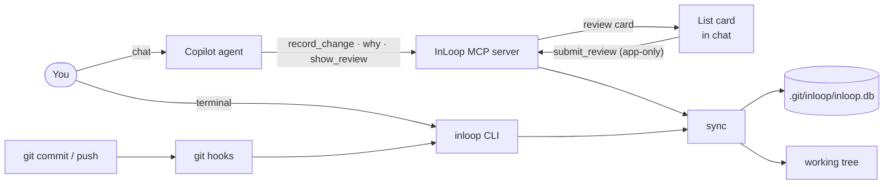

# InLoop

**Review what GitHub Copilot changed — and why, right in Copilot Chat.**

InLoop is a review companion for GitHub Copilot. Every time Copilot's agent changes your code, it leaves a short record — what changed, why, and what you should know — so the code you ship doesn't quietly pile up as **comprehension debt**.

You can review those records without leaving Copilot Chat: read them as Markdown, highlight any line and use **Ask in Side Panel** to dig into a detail without breaking the main chat's reading order, and confirm what you understand from a compact card. Under the hood it's a local MCP server built only on what Copilot already supports — MCP tools, MCP Apps and custom instructions — so there's nothing to patch and nothing leaves your machine.

> [!NOTE]
> **Comprehension debt** is the gap between how much code a system has and how much of it anyone truly understands ([Addy Osmani](https://addyosmani.com/blog/comprehension-debt/), [O'Reilly](https://www.oreilly.com/radar/comprehension-debt-the-hidden-cost-of-ai-generated-code/)). AI agents widen it fast: in an Anthropic randomized trial with 52 engineers, the group that learned a new library with AI finished about as fast but scored 17% lower on comprehension (50% vs 67%). In InLoop, your unreviewed records are your comprehension debt — `inloop list` and the commit hook show how much you have.

InLoop started from a constraint: during my internship, GitHub Copilot was the only AI coding tool I could use. Existing tools record who wrote a line (git-ai) or how the agent reasoned (Entire), but none of them help a Copilot user review what the agent just did. InLoop fills that gap inside the tool you're already allowed to use.

In the age of AI, internships and jobs all demand output. AI-generated code and implementations keep pushing us forward. Of course we can ship faster with AI, but shipping faster doesn't make us better engineers. I hope that by reviewing each change properly — its What, How and Why — we can truly learn from it, so speed and growth go together.

## Why InLoop

| Without InLoop | With InLoop |
| --- | --- |
| Copilot touched 6 files, edited some twice, and left one big diff | One record per reason, with a key point and only the hunks that matter |
| The "why" disappears when the chat closes | Records live next to your repo and follow your commits |
| The next session undoes last week's decision | Copilot reads past records before editing a file |
| Nothing tells you how much you don't understand | Unreviewed records are your comprehension debt — shown by `inloop list` and at commit |

## How it works



1. **Record.** After each meaningful change, Copilot calls `record_change`. InLoop takes the hunks from `git diff`, fingerprints them, and skips anything already recorded. `find_unrecorded` and the pre-commit hook catch changes the agent forgot.
2. **Review.** `/inloop.review` prints the records as Markdown and shows a list card. Press **Confirmed**, **Incorrect** or **Not important**, or say "open the confirm list" to tick several at once. Highlight any line of the Markdown and use **Ask in Side Panel** to dig in.
3. **Stay true.** Records are append-only. Every read runs `sync`, which matches each record's hunks against the current files and derives its status. Nothing about the code's state is stored as fact, so edits, reverts, amends, rebases and renames never leave stale records.
4. **Look it up.** Ask "why is line 42 of `retry.ts` written this way?" — Copilot calls `why` and gets the records covering that line.

### A record

```markdown
### #14 Retry uses exponential backoff `unreviewed`
> **Key point:** Wait time doubles after each failure so the downstream service can recover.

- **What & How:** Fixed 1s retry → 1, 2, 4, 8s, max 5 attempts (`retry.ts`).
- **Why:** A fixed interval makes every client retry at the same moment when the service is down.
- **You should know**
  - **Concept** | Jitter adds random delay so clients don't retry in sync.
  - **Risk** | The 5-attempt limit is hard-coded.
```

### Status

| Existence | Meaning |
| --- | --- |
| `present` | ≥ 90% of the recorded lines are still in the file |
| `modified` | 10–90% remain — someone edited it since |
| `gone` | < 10% remain |
| `discarded` | Gone before it was ever committed |
| `superseded` | A newer record explicitly replaced it |

| Review | Meaning |
| --- | --- |
| `unreviewed` | Not reviewed yet (or the record was amended) |
| `confirmed` | You confirmed the key point |
| `changed after confirm` | The code changed after you confirmed it |
| `incorrect` | You marked the explanation wrong; the agent should amend it |
| `not important` | Dropped from the review list |

## Install

**Requirements:** Node.js ≥ 22.13, Git, VS Code with GitHub Copilot.

InLoop isn't on npm yet. Install from source:

```bash
git clone https://github.com/Howardisme/inloop.git
cd inloop
npm install
npm run build
npm link            # puts `inloop` on your PATH
```

Then, in the repository you want to track:

```bash
inloop init
```

By default `inloop init`:

1. Appends a marked block to four git hooks (`pre-commit`, `post-commit`, `post-rewrite`, `pre-push`). Existing hook content is kept.
2. Adds an `inloop` server to your VS Code user `mcp.json` (backed up once as `mcp.json.inloop-bak`).
3. Adds agent instructions to `<VS Code User>/prompts/inloop.instructions.md` and a marked block in `~/.copilot/copilot-instructions.md`.

| Option | Effect |
| --- | --- |
| `--mcp workspace` | Write `.vscode/mcp.json` in this repo instead |
| `--mcp none` / `--instructions none` / `--no-hooks` | Skip that part |
| `--instructions repo` | Write `.github/copilot-instructions.md` (gets committed) |

`inloop uninstall` removes exactly what InLoop added.

### FAQ

For common installation and startup questions, see the [FAQ](docs/faq.md).

## Usage

**In Copilot Chat**

| Say | What happens |
| --- | --- |
| `/inloop.review [scope]` | Show records — unreviewed (default), `all`, `today`, a file, or `since:<ref>` |
| "open the confirm list" | A checklist form above the chat input; only you can submit it |
| `/inloop.capture` | Record changes the agent missed |
| `/inloop.why <file[:line]>` | Why is this code written this way? |

**In the terminal**

```bash
inloop list                  # unreviewed records and your review backlog
inloop why src/retry.ts:42   # records behind a file or line
inloop confirm 3 4           # confirm without the chat UI
inloop pr --base main        # a PR description section
inloop export --format md    # export all records
```

**Settings**

```bash
git config inloop.prePush block   # block pushes with unreviewed records (default: remind only)
git config inloop.why off         # stop the agent from querying past records
```

## Privacy and security

- Local only: no network calls; data stays in `.git/inloop/inloop.db` (SQLite, WAL).
- The agent can't confirm: `submit_review` is app-only and is registered only for clients that support MCP Apps.
- Record text is untrusted: it is escaped in Markdown, rendered as plain text in the card, and returned to the agent marked as data, not instructions.
- File paths are checked to stay inside the repository.

## Known limitations

- Copilot CLI–style chats don't run MCP prompts; `/inloop.*` works because the installed instructions tell Copilot which tool to call.
- Copilot Chat Markdown doesn't support `<details>`, so diffs are shown in full.
- Git hooks can't prompt, so `pre-push` reminds by default instead of asking.
- `inloop init` rewrites `mcp.json` without its comments (a backup is kept).

## Contributing

Contributions are welcome.See [CONTRIBUTING.md](CONTRIBUTING.md) for more details.

## License

[MIT](LICENSE)  
